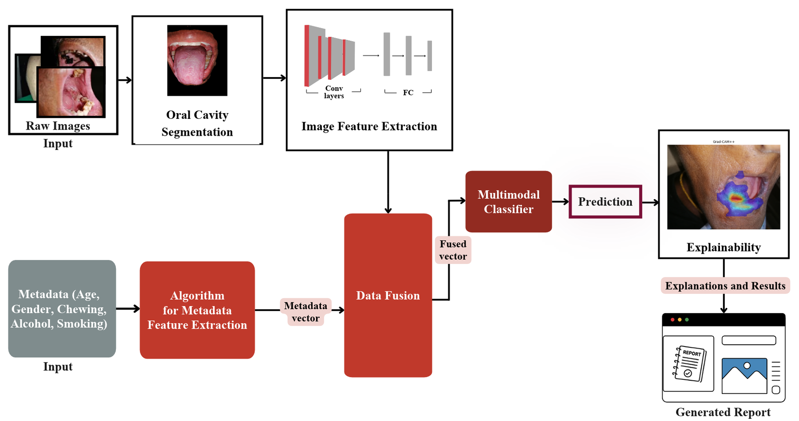
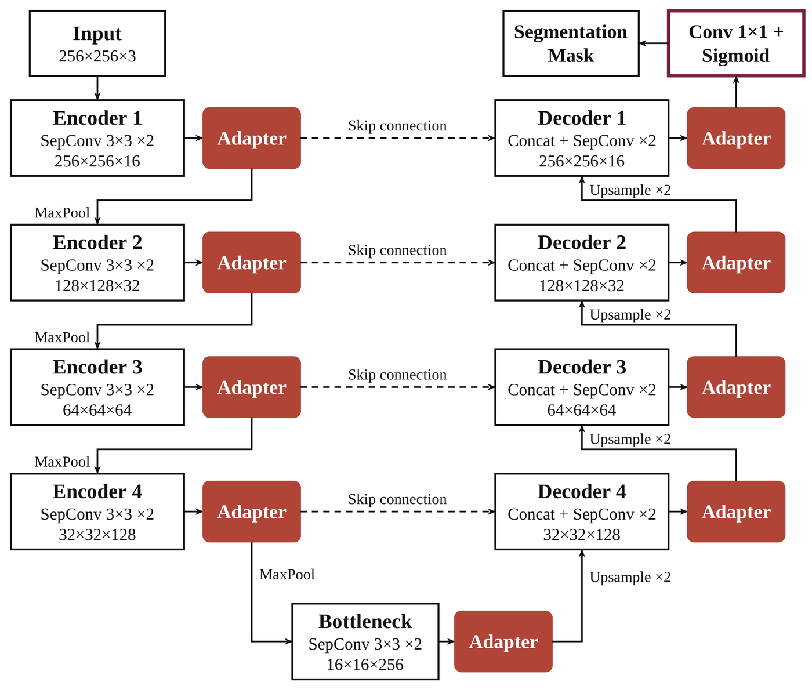
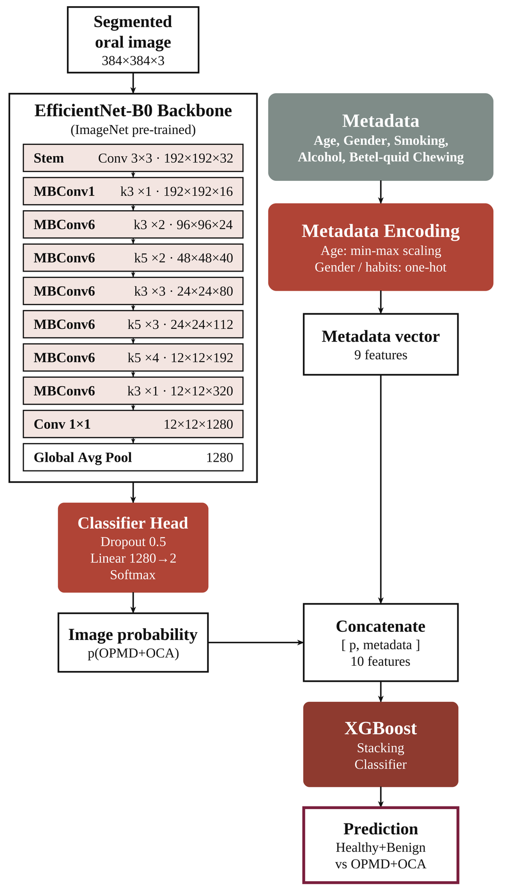
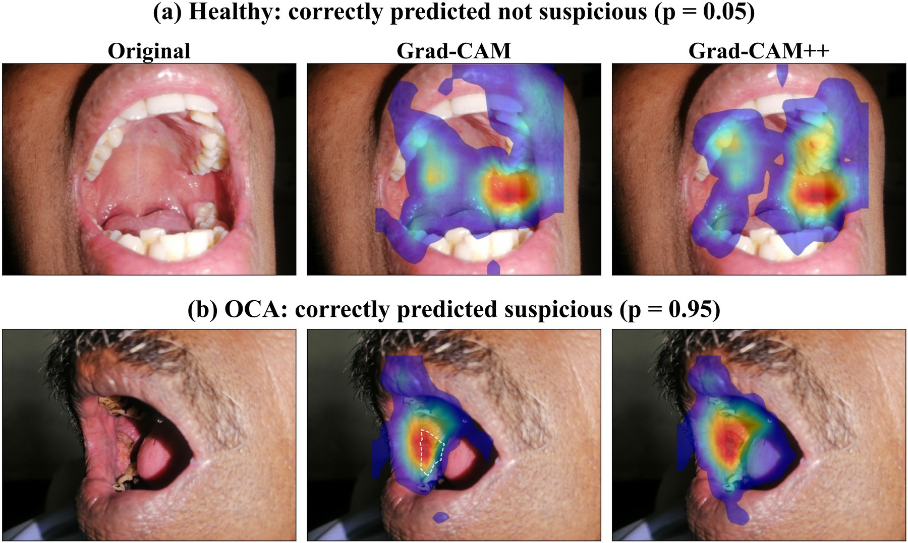
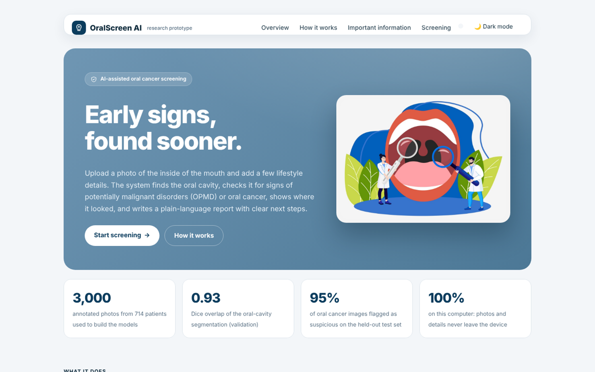

<h1 align="center">OralScreen AI</h1>
<p align="center"><b>Explainable oral cancer screening from intra-oral photographs and patient metadata</b></p>

<p align="center">
  
  
  
  
  
  
</p>

<p align="center">
  <a href="https://aie25002-oralscreen-ai-website-3zmtkcvdzt8snqsdeyvhqj.streamlit.app/"></a>
  <a href="https://oralscreen-ai-3nloatzwnkaypoqubwkfpy.streamlit.app/"></a>
</p>

<p align="center">
  
</p>

---

## Links

| | Link |
|---|---|
| Project website | <https://aie25002-oralscreen-ai-website-3zmtkcvdzt8snqsdeyvhqj.streamlit.app/> |
| Screening app (live demo) | <https://oralscreen-ai-3nloatzwnkaypoqubwkfpy.streamlit.app/> |
| Screening app source (deployed version) | <https://github.com/annapoorna-a-k/oralscreen-ai> |
| Project website source | <https://github.com/annapoorna-a-k/oralscreen-ai-website> |
| Dataset (Zenodo) | <https://zenodo.org/records/10664056> |

## Overview

Oral cancer is among the most common cancers in India and is often detected late because specialist screening is scarce. This project is a lightweight, explainable screening pipeline that:

1. **Segments the oral cavity** from a clinical photograph with a fine-tuned Mobile U-Net.
2. **Classifies the segmented image** with EfficientNet-B0 as *not suspicious* (Healthy, Benign) or *suspicious* (OPMD, oral cancer).
3. **Fuses the image probability with patient metadata** (age, sex, smoking, alcohol, betel quid chewing) using an XGBoost stacking classifier.
4. **Explains each prediction** with Grad-CAM heatmaps and SHAP risk-factor contributions.
5. **Writes a plain-language report** with next steps and tobacco-cessation advice, optionally rewritten by a LoRA fine-tuned Qwen2.5-1.5B model guarded by a rule-based safety check.

> **Disclaimer:** this is an M.Tech research prototype. It is a screening aid, **not** a diagnostic tool, and has not been clinically validated.

## System architecture

<p align="center">
  
</p>

## Results (held-out patient-level test set)

| Component | Model | Key result |
|---|---|---|
| Segmentation | Mobile U-Net + adapters (0.29 M params) | Dice **0.9428**, IoU **0.8921** (validation) |
| Image classifier | EfficientNet-B0, 384 × 384 | Accuracy 0.733, AUC 0.813 |
| Metadata classifier | XGBoost | Accuracy 0.711, AUC 0.800 |
| **Final model** | **EfficientNet-B0 + XGBoost stacking (L4)** | **Accuracy 0.785, AUC 0.854, sensitivity 0.714, specificity 0.870** |

Per-class (final model): 94.6% of oral cancer and 68.1% of OPMD images flagged as suspicious; 91.2% of Healthy and 82.8% of Benign images correctly cleared.

**Dataset:** 3,000 intra-oral images from 714 patients (Zenodo oral cavity dataset, Piyarathne *et al.*), split by patient into train / validation / test (476 / 119 / 119 patients) so that no patient appears in more than one split. The dataset is **not** included in this repository.

## Model details

<table>
<tr>
<td align="center" width="55%"><br><sub>Mobile U-Net with adapter modules (segmentation)</sub></td>
<td align="center" width="45%"><br><sub>EfficientNet-B0 + metadata, fused by XGBoost stacking</sub></td>
</tr>
</table>

## Explainability

<p align="center">
  
</p>

- **Grad-CAM / Grad-CAM++** show where the image model looked. On the test set the hottest point fell inside the annotated lesion 2.2× more often than chance.
- **SHAP (TreeSHAP)** shows how much each patient factor raised or lowered the score. On average about 59% of each decision came from the image and 41% from metadata; betel quid chewing was the strongest factor.

## Web application

<p align="center">
  
</p>

The Streamlit app (in [`app/`](app)) takes a photo and optional patient details and shows the segmentation, the screening result, the Grad-CAM heatmap, the SHAP chart and a report with four fixed sections: **Result**, **What influenced the result**, **What to do next** and **Reducing your risk**. It runs entirely on CPU.

## Repository structure

```
├── app/                      Streamlit application
│   ├── app.py                user interface
│   ├── pipeline.py           segmentation, classification, Grad-CAM, SHAP
│   ├── summary_generator.py  report template, safety validator, LLM rewriter
│   ├── llm_worker.py         runs the language model in a separate process
│   ├── theme.py              light / dark theme and page layout
│   ├── assets/               illustration used on the landing page
│   ├── models/               ONNX and XGBoost model files
│   ├── requirements.txt      core dependencies
│   └── requirements-llm.txt  optional: AI-written report (Qwen + LoRA)
├── notebooks/                training and experiment notebooks (see notebooks/README.md)
├── docs/images/              figures used in this README
├── INSTALL.md                installation and run guide
├── LICENSE                   MIT licence
└── README.md
```

Training and experiment notebooks are in [`notebooks/`](notebooks), numbered in pipeline order.

## Quick start

```bash
git clone https://github.com/annapoorna-a-k/Oral-Cancer-Detection-and-Multiclass-Classification.git
cd Oral-Cancer-Detection-and-Multiclass-Classification/app
python -m venv .venv && source .venv/bin/activate
pip install -r requirements.txt
streamlit run app.py
```

See [INSTALL.md](INSTALL.md) for full instructions, including the optional AI-written report.

## Development history

| Period | Work |
|---|---|
| July 2026 | Literature review, metadata EDA |
| August 2026 | Oral-cavity segmentation: U-Net + ResNet34, DeepLabV3+ and Mobile U-Net; model comparison; patient-level split |
| September 2026 | Mobile U-Net tuning and fine-tuning, lesion-segmentation experiments, crop generation, augmentation, four-class backbone comparison |
| October 2026 | EfficientNet-B0 tuning, attention experiments, YOLO26 detect-crop-classify, synthetic data generation (diffusion, StarGAN) |
| November 2026 | Binary screening with metadata fusion, explainability, report-generation LLM, Streamlit application, documentation |


## Tech stack

PyTorch · timm · TensorFlow / Keras · ONNX Runtime · XGBoost · scikit-learn · SHAP · OpenCV · Hugging Face Transformers · PEFT (LoRA) · Streamlit

## References

- N. S. Piyarathne *et al.*, oral cavity image dataset with lesion and oral-cavity annotations, Zenodo.
- M. Tan and Q. V. Le, "EfficientNet: Rethinking model scaling for convolutional neural networks," *ICML*, 2019.
- R. R. Selvaraju *et al.*, "Grad-CAM: Visual explanations from deep networks via gradient-based localization," *ICCV*, 2017.
- S. M. Lundberg and S.-I. Lee, "A unified approach to interpreting model predictions," *NeurIPS*, 2017.
- E. J. Hu *et al.*, "LoRA: Low-rank adaptation of large language models," *ICLR*, 2022.
- Qwen Team, "Qwen2.5 Technical Report," arXiv:2412.15115, 2024.

## License

The code in this repository is released under the [MIT License](LICENSE). The dataset is not included and remains under its original licence; the illustration used in the banner and app belongs to its respective owner.

## Author

**Annapoorna A K** — M.Tech project, Oral Cancer Detection and Multiclass Classification.
